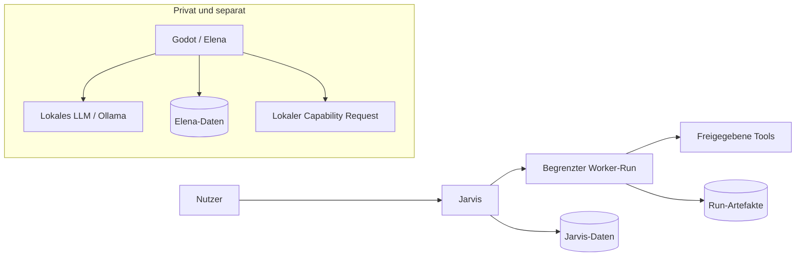

# Architektur und gemeinsame Begriffe

## Getrennte Vertrauensbereiche

Es gibt absichtlich keine automatische Verbindung zwischen dem privaten Bereich und Jarvis oder Workern. Eine spätere Verbindung ist ein eigener, ausdrücklich freizugebender Ausbau.

Jarvis plant; ein Runner prüft und führt Worker-Runs aus. Tools führen konkrete Operationen aus. Policies und Freigaben werden außerhalb des Modellprompts geprüft. Elena trifft lokale Absichtsentscheidungen; Godot besitzt die Autorität über die Welt und tatsächliche Aktionen.

## Gemeinsames Vokabular

Die folgenden Konzepte sind zunächst dokumentierte Verträge, keine gemeinsame Bibliothek oder zentrale Datenbank.

| Konzept | Bedeutung und minimale Daten |
| --- | --- |
| Task | Auftrag: ID, Ursprung, Ziel, explizite Eingaben, Ergebnis-/Abnahmekriterien, Datenbereich |
| Plan | Versionierter Vorschlag von Schritten; keine Ausführungserlaubnis |
| Run | Konkreter Versuch eines Tasks: ID, Planversion, Limits, Status, Policy-Version |
| Tool | Operation mit Ein-/Ausgabeschema, Seiteneffekten und benötigter Capability |
| Artifact | Ergebnis mit ID, Herkunfts-Run, Datenbereich, Integritätsreferenz und lokalem Speicherort |
| Capability | Eng begrenzte Fähigkeit: Operationen, Ressourcen, Einschränkungen, Ablaufzeit |
| Approval | Nutzerentscheidung für genau bezeichnete Operation, Eingaben und Grenzen |
| Event | Fachliches Ereignis mit ID, Zeit, lokaler Sequenz, Typ und Task-/Run-Bezug |
| Policy | Deterministische Regeln zu Daten, Tools, Limits, Freigaben und Verboten |

IDs oder Artifact-Referenzen allein gewähren keinen Zugriff. Jedes System löst Referenzen nur innerhalb seines eigenen Datenbereichs auf. Kein globaler Speicher, gemeinsames Gedächtnis, gemeinsamer Vektorindex oder automatisch synchronisierte Logs.

## Vorgeschlagener Worker-Lebenszyklus

`created → validating → awaiting_approval (falls nötig) → running → succeeded | failed | cancelled | limit_reached`

Vor Start müssen Policy, Eingaben und Budget gültig sein. Vor jedem Toolaufruf werden Rechte, verbleibende Limits und gegebenenfalls Approval erneut geprüft. Ein terminaler Run darf keine weiteren Tools starten. Abbruch stoppt neue Aufrufe und versucht laufende Operationen zu beenden; bereits eingetretene Seiteneffekte werden als Ergebnis erfasst, nicht als rückgängig behauptet.

Der Runner setzt eine harte Laufzeitgrenze, maximale Toolaufrufe und Kostenlimits durch. Vor einem kostenpflichtigen Aufruf muss dessen maximale reservierte Ausgabe innerhalb des Restbudgets liegen. Kann ein Tool diese Grenze nicht verlässlich begrenzen, wird es für den Run abgelehnt. Anbieter- und lokale Laufzeitkosten bleiben unterscheidbar.

## Technikentscheidungen bewusst vertagt

Für erste Slices reichen lokale, versionierte Schemas und ein einfacher persistierter Ablauf. Events dienen Nachvollziehbarkeit; daraus folgt kein Bedarf für Event Sourcing, Message Broker oder Microservices. Eine gemeinsame Schema-Bibliothek wird erst erwogen, wenn tatsächlich zwei Implementierungen dieselben Verträge benötigen. Elena darf sie unabhängig versionieren und erhält dadurch keinerlei Netzwerkverbindung.
